# 📐 Physical Design & RTL-to-GDSII Flow

## 📖 Overview
This directory documents the complete physical design implementation stages for the **Vacancy-Delay Ventilation Controller**, generated using the automated OpenLane ASIC flow and visualized using Magic and layout viewers with the **Sky130A PDK** (`sky130_fd_sc_hd` library).

---

## 🏗️ Physical Design & Layout Stages

### 1. Design Preparation (`design_prep_in_openlane.png`)
Initializing tech-lefs, standard cell libraries, and design parameters inside OpenLane:
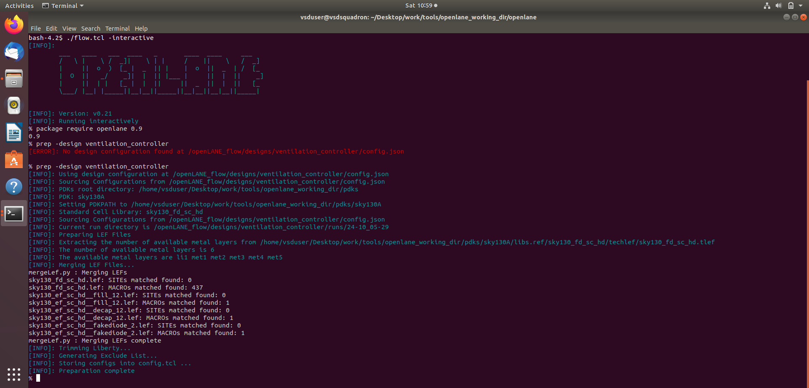

---

### 2. Floorplanning & Floorplan DEF View (`floorplan.png` & `ventilation_controller.floorplan.def.png`)
Defining core utilization, die boundaries, power distribution networks, and initial floorplan structures:
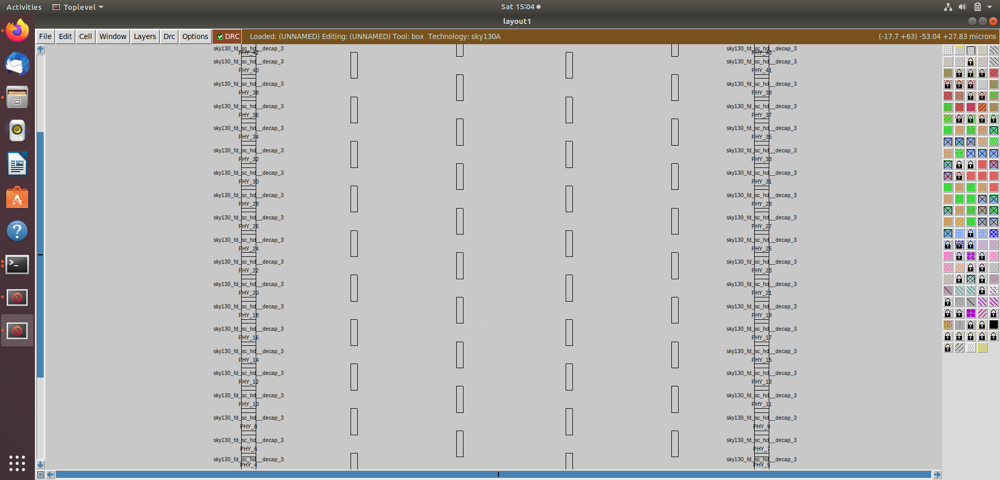

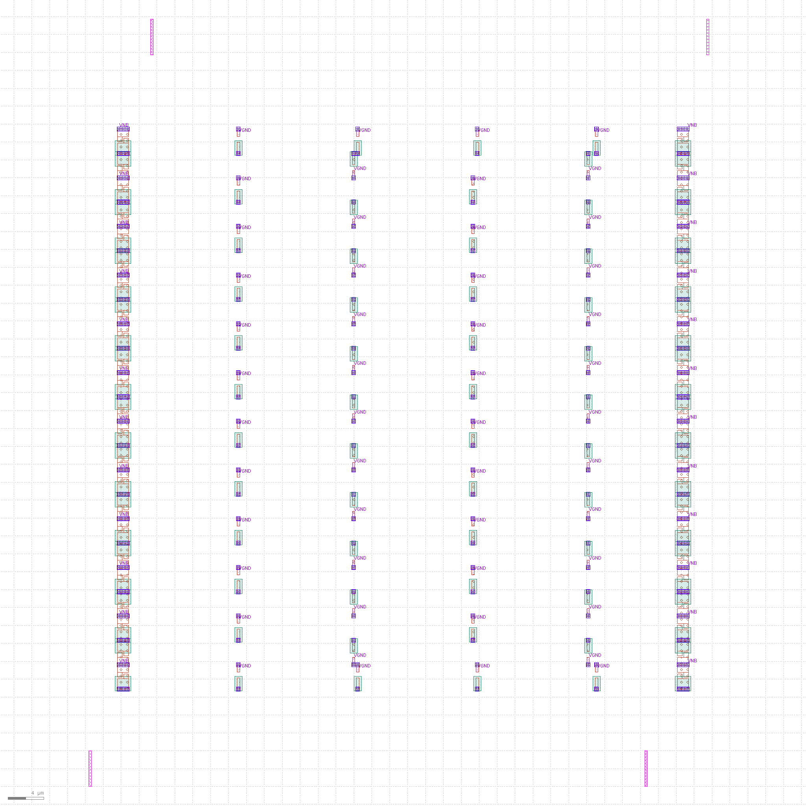

---

### 3. Placement & Placement DEF View (`placement_zoomed_in.png` & `ventilation_controller.placement.def.png`)
Legalizing and placing standard cells to optimize wirelength and avoid congestion:
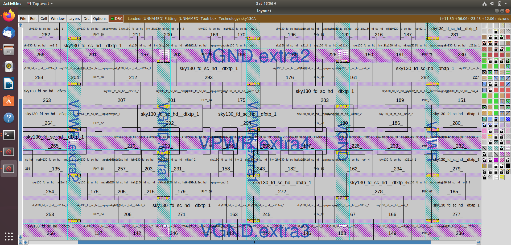

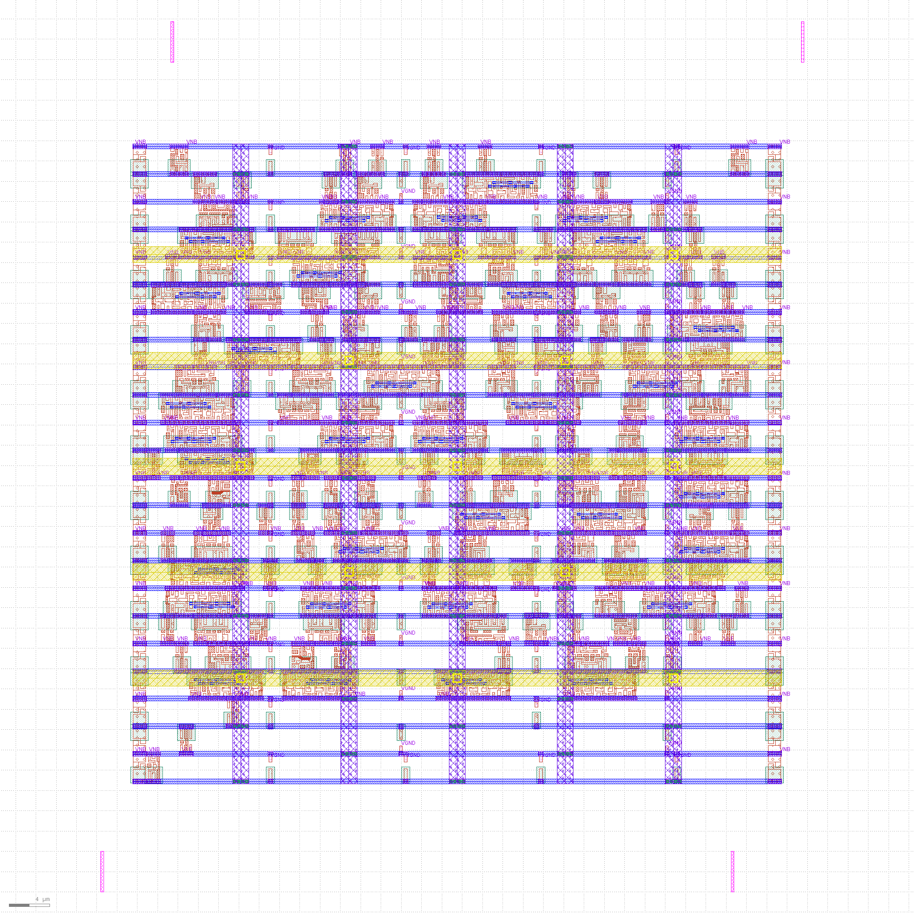

---

### 4. Clock Tree Synthesis (CTS) (`ventilation_controller.cts.def.png`)
Balancing clock skew and buffering the clock distribution network:
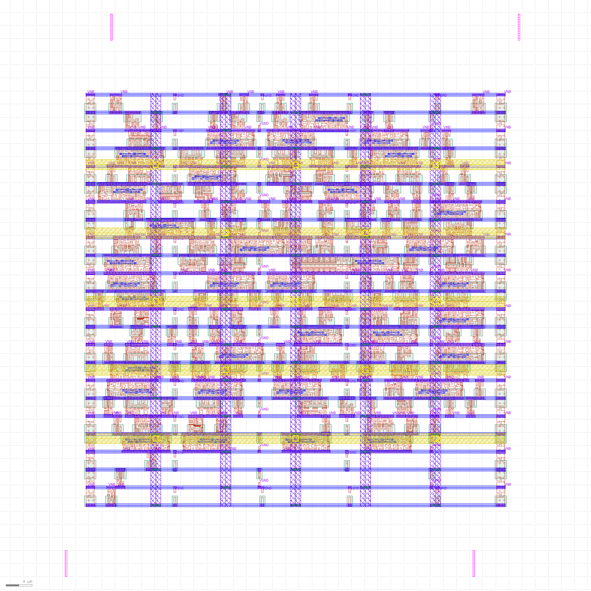

---

### 5. Routing & Detailed DEF Views (`routing_zoomedin.png` & `ventilation_controller.def.png`)
Interconnecting standard cells across metal layers (Met1 through Met4) without DRC violations:
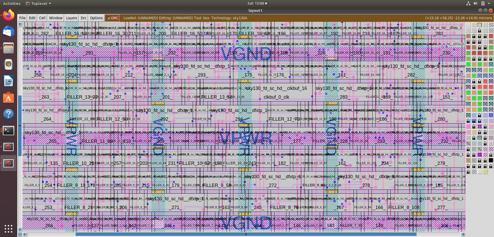

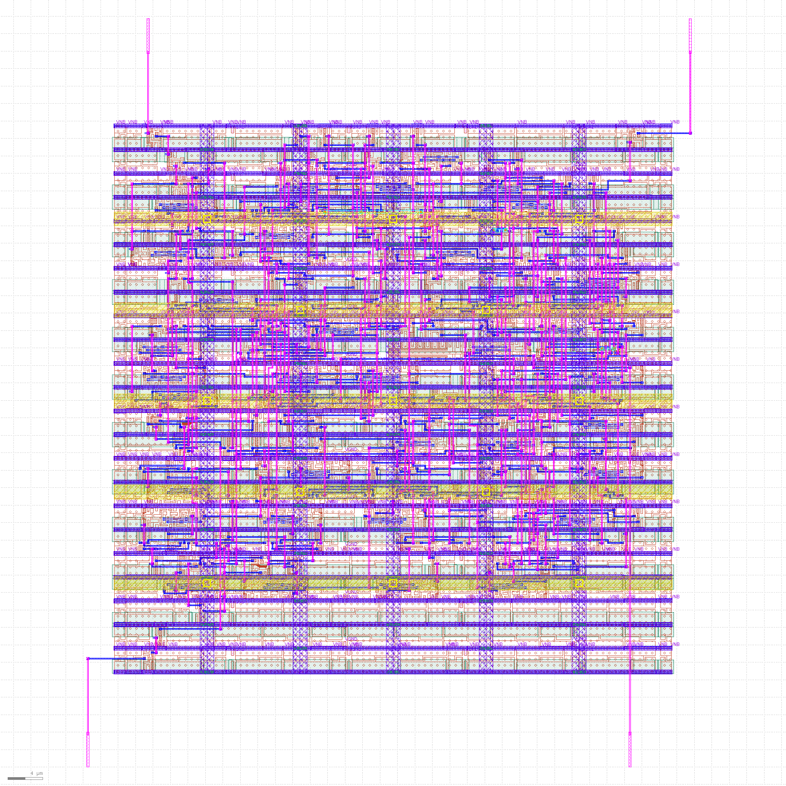

---

### 6. Standard Cell Architecture (`cell_in_design.png`)
Granular layout view of individual standard cells instantiated within the core grid:
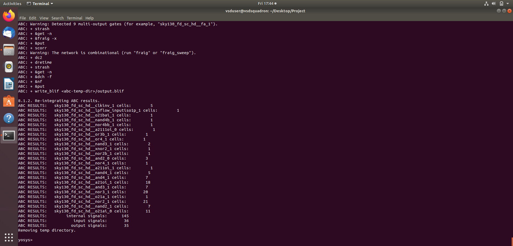

---

### 7. Final Routed Layout & GDSII Stream (`Routing_or_final_layout_stage.png` & `ventilation_controller.gds.png`)
The final layout stream ready for tapeout and fabrication verification:
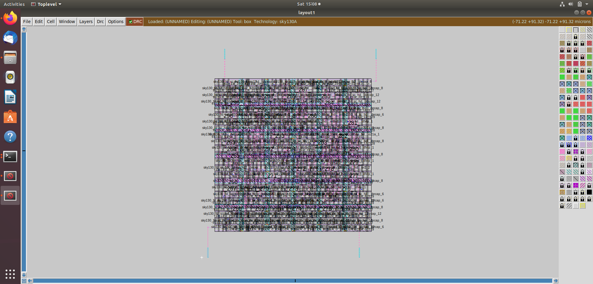

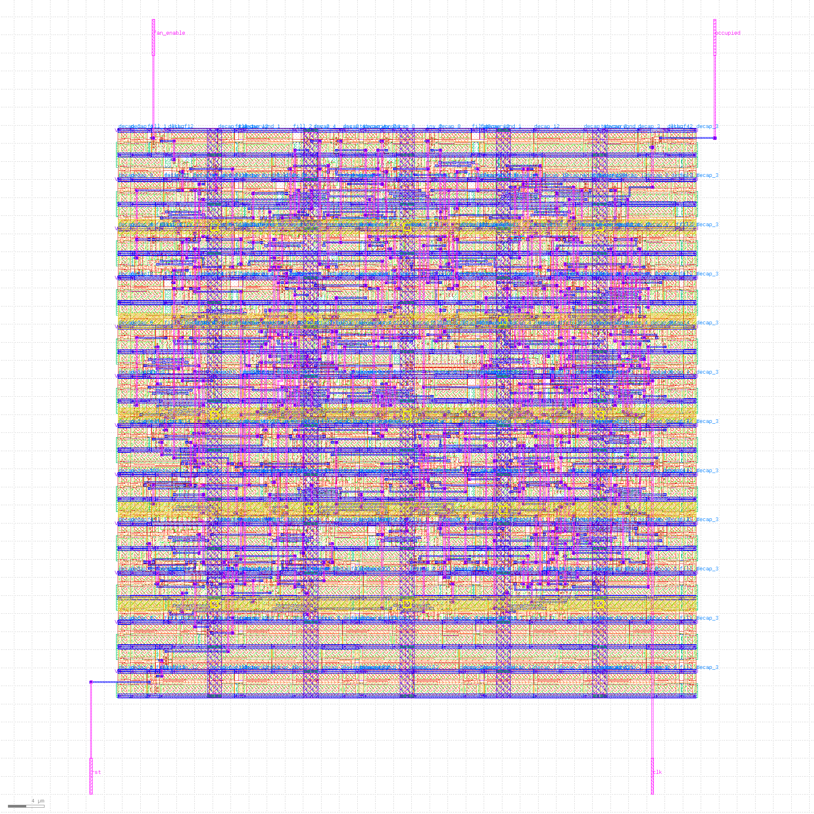
