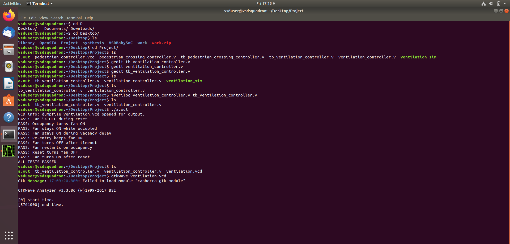
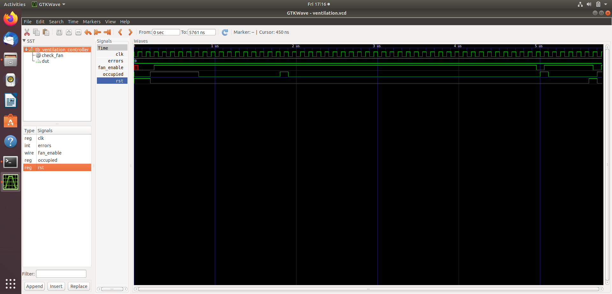

# 🧪 Functional Simulation & Verification

## 📖 Overview
Before proceeding to RTL synthesis and physical design, the **Vacancy-Delay Ventilation Controller** was thoroughly verified using a self-checking testbench.

The simulation validates all operational states, including:
* Initial reset response and immediate occupancy detection.
* Continuous occupancy monitoring.
* Grace-period countdown tracking during room vacancy.
* **Occupancy Re-Entry Override:** Immediate cancellation of the shutdown sequence if occupants return during the grace period.
* Safe fan deactivation upon complete delay expiry.

---

## 📊 Simulation Waveforms & Results

### Simulation Execution & Pass Status
The testbench executes all test cases and verifies functional accuracy without timing errors:

---

### Waveform Analysis
The waveform below illustrates signal transitions during reset, active delay counting, re-entry override, and final fan shutdown:

