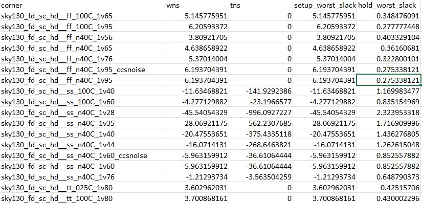
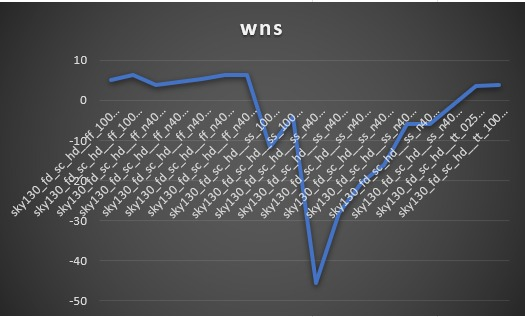
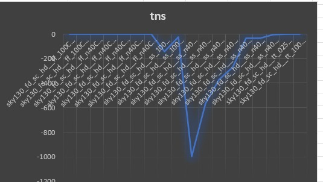
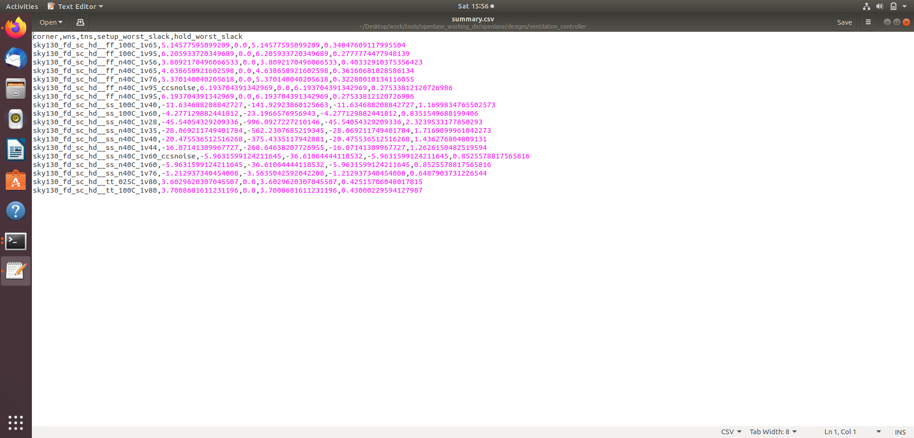

# ⏱️ Static Timing Analysis (STA) & Multi-Corner Signoff

## 📖 Overview
This directory contains the timing signoff documentation for the **Vacancy-Delay Ventilation Controller**. Static Timing Analysis (STA) was performed across multiple Process, Voltage, and Temperature (PVT) corners using the Sky130 PDK standard cell libraries to ensure robust timing compliance and zero setup/hold violations.

---

## 📊 Timing Analysis & Multi-Corner Signoff

### 1. STA Comparison Table (`sta_comprasion_table`)
The comparison table compiles Worst Negative Slack (WNS) and Total Negative Slack (TNS) across different operating corners:

---

### 2. Worst Negative Slack (Wns) Trends (`wns`)
Graphical representation of Wns variations across the evaluated corners:

---

### 3. Total Negative Slack (Tns) Trends (`tns`)
Graphical representation of Tns performance trends:

---

### 4. PVT Timing Summary Report (`pvt_corners_timing_summary_dot_cvs`)
Detailed log output verifying signoff parameters:

