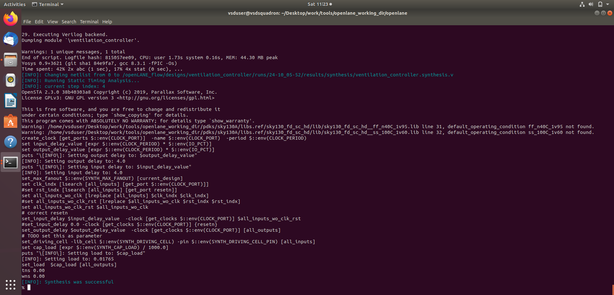
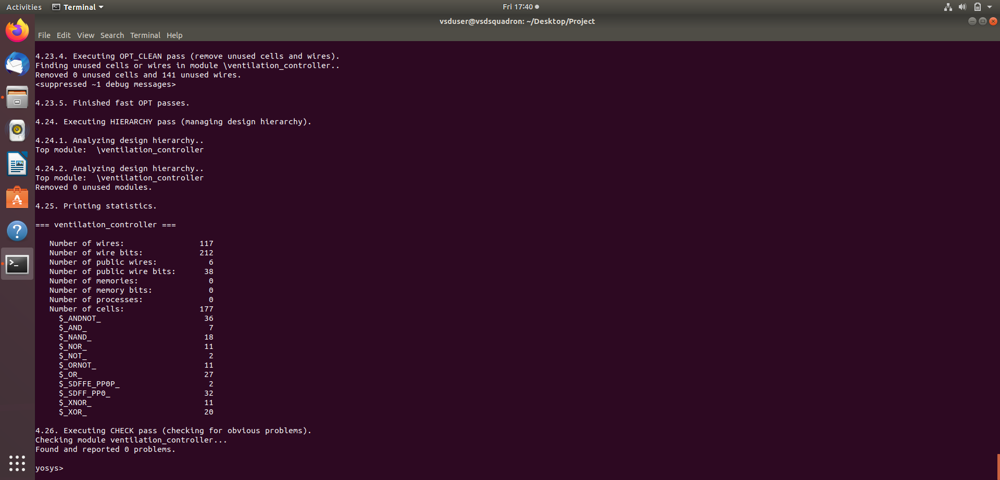
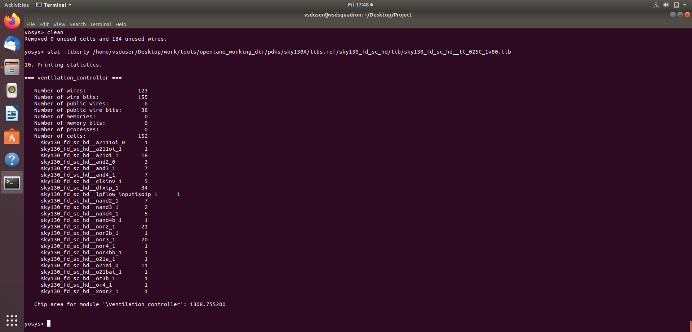
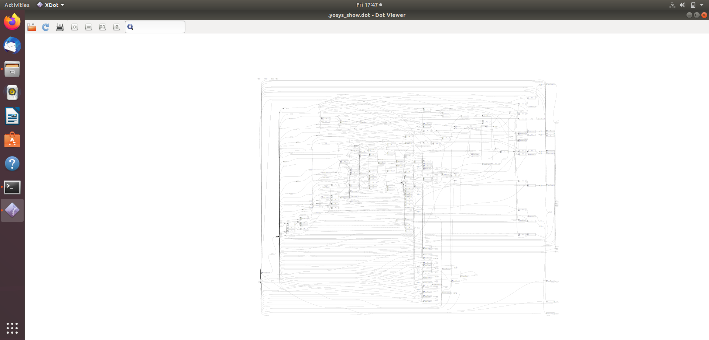
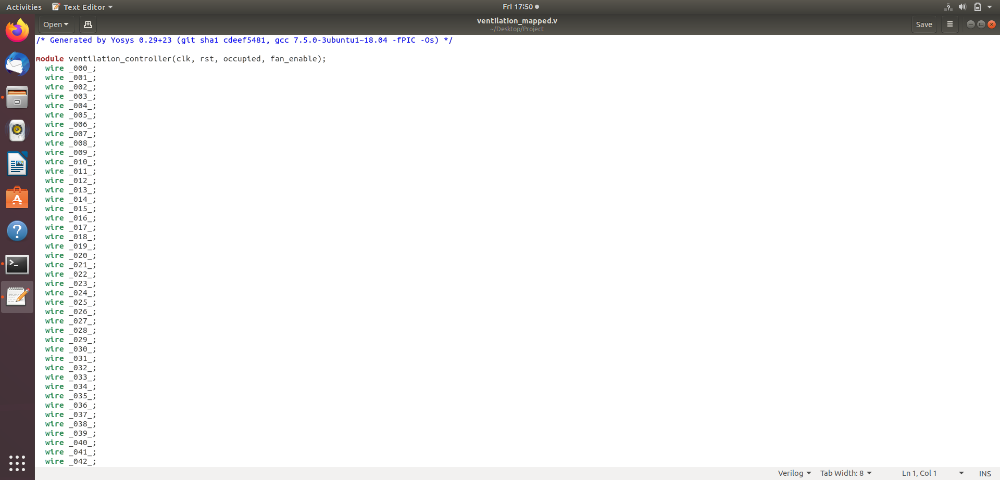
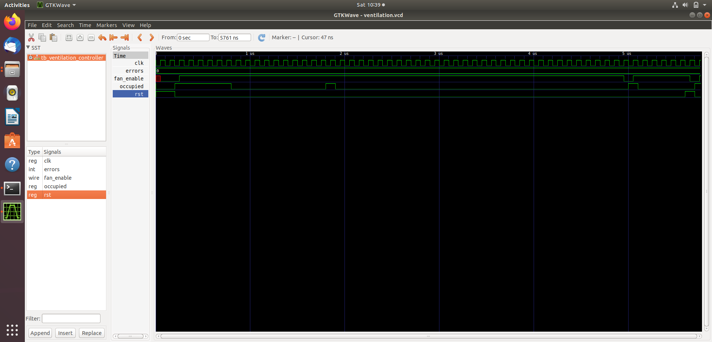

# ⚙️ Synthesis, Netlist & Gate-Level Simulation (GLS)

## 📖 Overview
This directory contains the core implementation artifacts for the **Vacancy-Delay Ventilation Controller**, covering RTL synthesis execution, standard-cell statistics, netlist optimization, and Gate-Level Simulation (GLS) verification using the Sky130A PDK.

---

## 📊 Synthesis & Netlist Generation

### 1. OpenLane Synthesis Run
The synthesis execution successfully maps the FSM and counter logic onto standard cells:

---

### 2. Synthesis Statistics (`stat`)
The statistics report provides a breakdown of cell instances, area utilization, and resource distribution:

---

### 3. Netlist Cleaning & Optimization
Post-processing optimization cleans up redundant internal wires and optimizes standard-cell instances:

---

### 4. Gate-Level Netlist Views (`netlist` & `netlist_dot_v`)
The resulting structural netlists represent the synthesized hardware layout:

---

## 🧪 Gate-Level Simulation (GLS)

### Gate-Level Verification
Gate-level simulation verifies that the synthesized netlist behaves identically to the behavioral RTL under timing and structural constraints:

